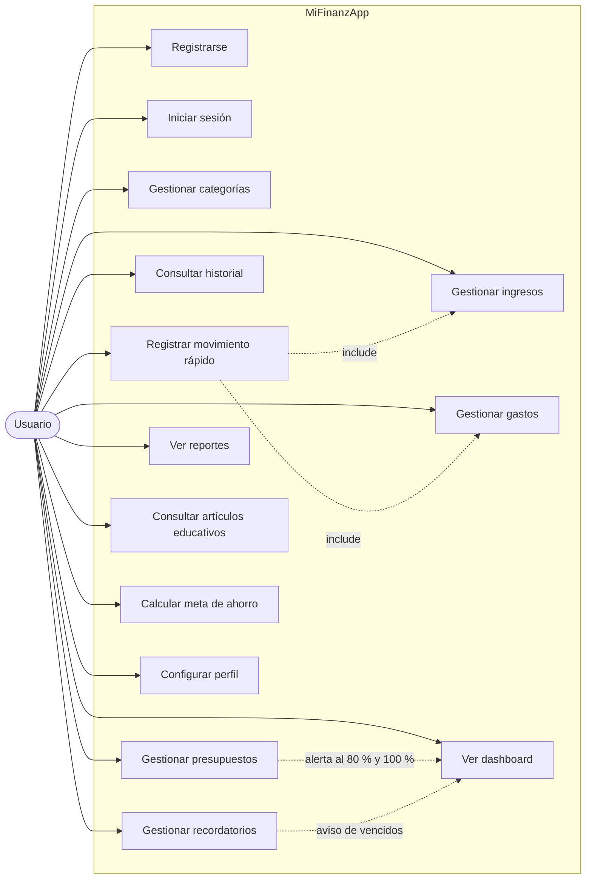

# Casos de uso

## Actores

- **Usuario**: persona que registra y consulta sus finanzas personales.
- **Sistema**: aplicación web Mi FinanzApp (incluye el proceso de alertas al iniciar sesión).

## Diagrama

## Descripción resumida

| ID | Caso de uso | Descripción | Implementado en |
|---|---|---|---|
| CU1 | Registrarse | Crea la cuenta y genera categorías predeterminadas. Rechaza emails repetidos. | `/auth/registro` |
| CU2 | Iniciar sesión | Acceso con email y contraseña (BCrypt). | `/auth/login` |
| CU3 | Gestionar categorías | Crear, editar y eliminar categorías de ingreso o gasto. | `/categorias` |
| CU4 | Gestionar ingresos | CRUD completo; implementado con JDBC explícito. | `/ingresos` |
| CU5 | Gestionar gastos | Crear, editar y eliminar gastos. | `/gastos` |
| CU6 | Registrar movimiento rápido | Formulario único para ingreso o gasto. | `/movimientos/nuevo` |
| CU7 | Consultar historial | Lista paginada con filtros por fecha, tipo, categoría y texto. | `/historial` |
| CU8 | Gestionar presupuestos | Presupuesto mensual por categoría con alertas. | `/presupuestos` |
| CU9 | Gestionar recordatorios | Recordatorios con estado «hecho» y aviso de vencidos. | `/recordatorios` |
| CU10 | Ver dashboard | Resumen del mes y alertas. | `/dashboard` |
| CU11 | Ver reportes | Gráficos de ingresos, gastos y evolución. | `/reportes` |
| CU12 | Consultar artículos educativos | Cinco artículos con consejos según los datos del usuario. | `/educacion` |
| CU13 | Calcular meta de ahorro | Calculadora de ahorro. | `/educacion` |
| CU14 | Configurar perfil | Cambiar nombre y moneda. | `/configuracion` |
