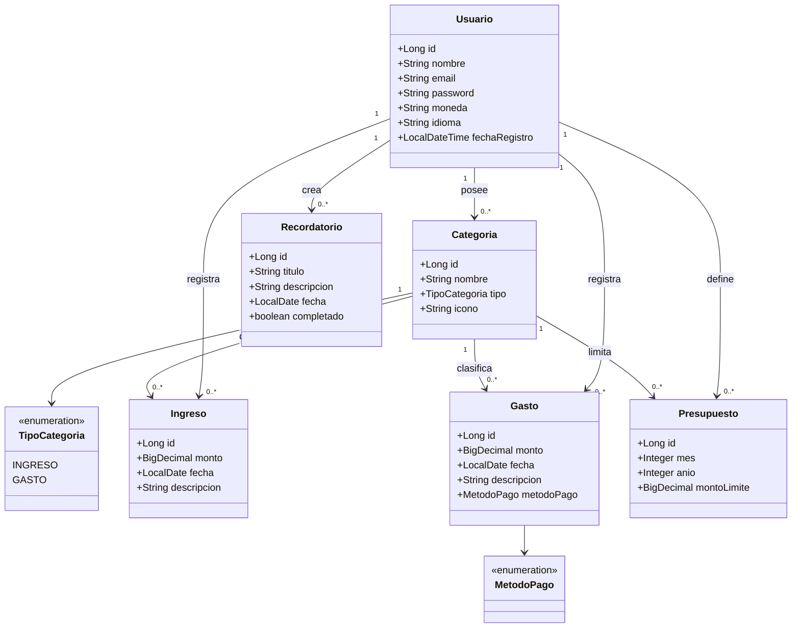

# Diagrama de clases — modelo de dominio

Entidades JPA de `com.mifinanzapp.entity`. Todas las entidades de movimientos pertenecen a un `Usuario`
(multi-tenancy por usuario).

## Reglas de negocio reflejadas en el modelo

- Una categoría es de tipo `INGRESO` o `GASTO`; al guardar un movimiento se valida que la categoría sea del usuario y del tipo correcto.
- No puede haber dos presupuestos con la misma combinación categoría + mes + año.
- Los importes son `BigDecimal` para evitar errores de redondeo con dinero.
- Cada consulta filtra por `usuario_id`; un registro ajeno se trata como inexistente (404).
