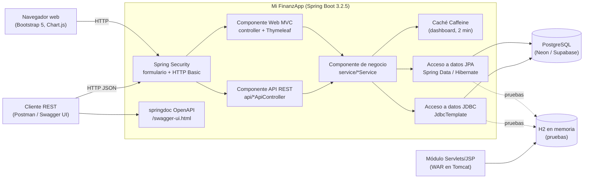

# Diagrama de componentes (GA8-220501096-AA1-EV01)

| Componente | Interfaz que ofrece | Depende de |
|---|---|---|
| Web MVC | Páginas HTML (`/dashboard`, `/ingresos`, ...) | Negocio, Thymeleaf, Security |
| API REST | JSON en `/api/**` | Negocio, Bean Validation, Security |
| Negocio | Servicios Java (`GastoService`, `IngresoService`, ...) | Acceso a datos, Caché |
| Acceso a datos | Repositorios JPA y JDBC | PostgreSQL (H2 en pruebas) |
| Seguridad | Autenticación por formulario (web) y HTTP Basic (API), BCrypt, CSRF | `CustomUserDetailsService` |
| Módulo Servlets/JSP | CRUD de categorías en `/categorias` (WAR) | JDBC sobre H2 |
