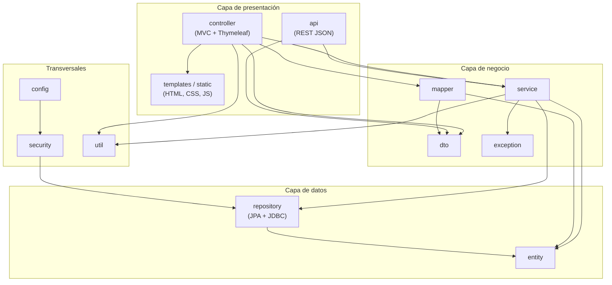

# Diagrama de paquetes (GA8-220501096-AA1-EV01)

Paquetes de la aplicación principal (`com.mifinanzapp`) y del módulo de servlets (`com.mifinanzapp.servlets`).
Las flechas indican dependencia ("usa").

| Paquete | Responsabilidad |
|---|---|
| `controller` | Controladores MVC que reciben peticiones del navegador y devuelven vistas Thymeleaf. |
| `api` | Controladores REST (`/api/**`), records de entrada con validación y respuestas DTO. |
| `service` | Reglas de negocio, autorización por propietario, transacciones y caché. |
| `dto` / `mapper` | Objetos de transferencia y conversión entidad ↔ DTO. |
| `repository` | Acceso a datos: Spring Data JPA y `IngresoJdbcRepository` con SQL explícito. |
| `entity` | Modelo de dominio JPA (Usuario, Categoria, Ingreso, Gasto, Presupuesto, Recordatorio). |
| `exception` | Excepciones de negocio y manejador global de errores. |
| `security` | Carga de usuarios para Spring Security (`CustomUserDetailsService`). |
| `config` | Seguridad, caché, OpenAPI, carga de `.env`, datos demo y atributos globales. |
| `util` | Utilidades de fechas y montos. |
| `servlets.*` | Módulo independiente con Servlets/JSP: `config`, `dao`, `modelo`, `servlet`. |
