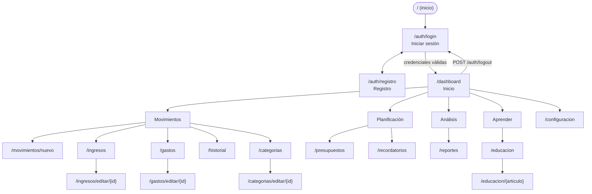

# Mapa de navegación (GA8-220501096-AA1-EV01)

- Todas las rutas, salvo `/auth/**`, los recursos estáticos y Swagger, exigen sesión; sin sesión se redirige a `/auth/login`.
- Los formularios envían `POST /<recurso>/guardar` o `POST /<recurso>/eliminar/{id}` y redirigen al listado (patrón Post/Redirect/Get).
- Los errores muestran las páginas 400, 404, 409 y 500 con un botón "Volver al inicio".
